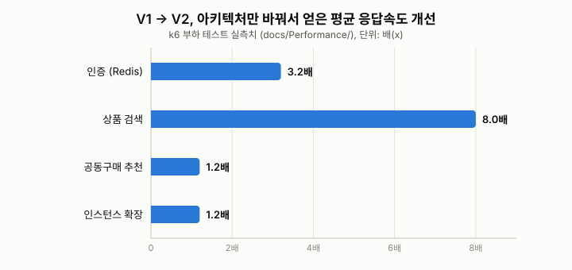

<div align="center">

### 이커머스 백엔드 (Spring Boot)

[](docs/Api) [](docs/Performance) []()

</div>

## 📝 소개

이커머스 서비스의 인증, 상품, 주문, 공동구매 추천 기능을 구현한 백엔드입니다.

그냥 기능만 만들고 끝내지 않고, 같은 기능을 다른 방식으로 다시 구현해서(V1/V2) k6로 부하를 직접 걸어보고 뭐가 왜 얼마나 빨라지는지 숫자로 확인해보는 걸 목표로 했습니다. 그 과정에서 부하 테스트 도중에만 드러나는 버그도 몇 개 발견했고, 그것도 아래 "기술적 이슈" 섹션에 정리해뒀습니다.

## ⚙ 기술 스택

- **Backend**: Java 21, Spring Boot 3.2, Spring Security + JWT, QueryDSL
- **DB/Cache**: PostgreSQL, Redis
- **Infra**: Docker, Docker Swarm, Prometheus + Grafana
- **부하 테스트**: k6

## 🔬 V1 vs V2로 비교해본 것들



| 영역 | V1 | V2 | 결과 |
| --- | --- | --- | --- |
| 인증 (Refresh Token) | DB 조회 | Redis 조회 | 평균 응답 3.2배 단축, DB 방식에서 나던 401 에러(아래 참고) 해소 |
| 상품 검색 | 다중 테이블 JOIN | 검색 전용 비정규화 테이블 | 평균 응답 8배 단축 |
| 공동구매 추천 | N+1 요청 | 단일 요청 | 캐시 미스 기준 평균 251ms → 210ms, 캐싱 적용 시 두 버전 모두 30배 이상 단축 |
| 인스턴스 수 | 1개 | 3개 (Swarm 로드밸런싱) | 평균 응답 17% 개선, RPS 5.7% 증가 |

자세한 테스트 조건과 분석은 `docs/Performance/` 아래에 항목별로 있습니다.

## 😡 기술적 이슈와 해결 과정

### Refresh Token을 DB로 관리했더니 부하 상황에서 로그인 직후 401이 남

인증 V1은 로그인할 때 Refresh Token을 DB(`refresh_token` 테이블)에 저장하고, 토큰 갱신 요청이 오면 DB에서 조회해서 대조하는 구조였습니다.

```java
RefreshToken savedToken = refreshTokenRepository.findByUsername(authentication.getName())
        .orElseThrow(() -> new IllegalArgumentException("Refresh token not found"));
```

k6로 VU 200명을 걸어보니 V1에서만 간헐적으로 401이 떴습니다. 로그로 따라가보니 원인은 이거였습니다: 로그인 응답으로 토큰을 받은 클라이언트가 곧바로 그 토큰으로 갱신을 요청하는데, 그 시점에 로그인 트랜잭션의 INSERT가 아직 커밋되지 않은 경우가 있었습니다. DB 입장에선 "그런 토큰 없음"이니 그대로 404/401로 처리된 거였고요.

Redis 기반(V2)으로 바꾸니 이 문제가 사라졌습니다. 단일 스레드로 원자적으로 처리되는 인메모리 저장소라 커밋 지연 자체가 없어지기 때문입니다. 자세한 수치는 `docs/Performance/auth/refresh.md`에 있습니다.

### V2 페이징 검색이 500을 뱉었던 이유

상품 검색 V2 API(`/api/v2/products/search/results`)에 정렬 파라미터 기본값을 그대로 복붙해서 넣었다가 터진 케이스입니다.

```java
// V1 엔티티(Product)의 PK 필드명을 그대로 기본값으로 사용
@RequestParam(defaultValue = "id") String sort
```

문제는 V2가 조회하는 엔티티(`ProductSearch`)의 PK 필드명은 `id`가 아니라 `productId`였다는 것. Spring Data JPA가 `id`라는 필드를 못 찾고 `QueryCreationException`을 던지면서 500으로 떨어졌습니다. k6로 실제 트래픽을 흘려보지 않았으면 코드 리뷰만으로는 놓치기 쉬운 버그였습니다.

```java
@RequestParam(defaultValue = "productId") String sort
```

## 🚀 실행 방법

### 로컬 (Docker Compose)

```powershell
docker build -t ecommerce-backend:latest .
docker compose up -d
```

Postgres, Redis, 백엔드(3 replica), Prometheus, Grafana가 함께 뜹니다. 비밀번호 등은 `.env.example`을 참고해 `.env`로 복사해서 쓰면 되는데, 안 만들어도 로컬 기본값으로 동작합니다.

### 운영 배포 (Docker Swarm)

실제 배포는 `docker-swarm.yml` 기준이고, CD는 `.github/workflows/cd.yml`에서 push 시 자동으로 실행됩니다.

```powershell
docker stack deploy -c docker-swarm.yml ecommerce
```

이쪽은 `.env`에 `POSTGRES_PASSWORD`, `JWT_SECRET` 등이 실제로 설정돼 있어야 배포가 진행됩니다.

### 테스트

```powershell
.\mvnw.cmd test

# k6 부하 테스트 (예: 상품 검색 V1 vs V2)
k6 run k6/tests/v2/search-results.js
```

## 📚 문서

- API 명세: `docs/Api/`
- 아키텍처/시퀀스 다이어그램: `docs/Diagram/`
- 부하 테스트 결과 및 분석: `docs/Performance/`
